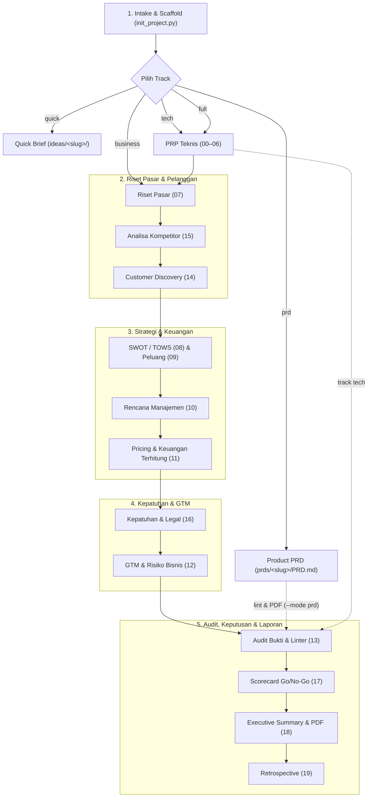

<p align="center">
  
</p>

# IdeaForge

[English](README.md) | **Bahasa Indonesia** | [简体中文](README.zh.md)

Workspace terstruktur untuk **AI Brainstorming Partner & Strategic Analysis Agent** yang kompatibel dengan **berbagai tool AI modern** (**Claude Code**, **OpenAI Codex**, **Antigravity**, **Gemini CLI**, **Cursor**, **GitHub Copilot**, **OpenCode**) melalui `AGENTS.md`, `CLAUDE.md`, `GEMINI.md`, `.cursor/rules/`, `.github/copilot-instructions.md`, dan `.agents/skills/`. Dirancang untuk mengawal ide mentah menjadi keputusan berbasis bukti: mulai dari eksplorasi ide, validasi bisnis, penyusunan PRP (*Project Requirements & Plan*), riset pasar, pemodelan keuangan terhitung, kepatuhan regulasi, hingga laporan eksekutif PDF—menggunakan **Python 3 stdlib murni** tanpa dependency `pip` eksternal.

---

## Keunggulan Utama

- **Engagement Tracks Sesuai Kebutuhan**: Tidak *one-size-fits-all*. Setiap permintaan diklasifikasikan ke track `quick` (ringkasan 1–2 halaman), `prd` (Product Requirements Document siap coding-agent), `tech` (PRP teknis & arsitektur), `business` (studi kelayakan komersial), atau `full` (lengkap) via `project-intake` dan `scripts/init_project.py`.
- **Alur Bertahap dengan Checkpoint**: Analisis berjalan langkah demi langkah; agent merangkum hasil, menjalankan *red-team* singkat, dan meminta persetujuan sebelum lanjut ke tahap berikutnya.
- **Standar Bukti & Linter Otomatis**: Setiap angka dilabeli `[Verified]`, `[Estimate]`, `[Assumption]`, atau `[Unverified]`, sumber diberi grade `A`/`B`/`C` beserta tanggal akses, dan `scripts/lint_project.py` memvalidasi link, aritmatika scorecard, kelengkapan PRD (section, ID FR, Given/When/Then), data kedaluwarsa, serta anti-*AI slop*.
- **Model Keuangan Terhitung (Transactional & SaaS)**: `model.py` menghitung 3 skenario (pesimis, dasar, optimis), CAPEX, *channel fee*, pajak, *runway* eksak, LTV/CAC, *payback period*, sensitivitas 2-arah, dan grafik SVG otomatis.
- **Export PDF Editorial + Mermaid**: `export_pdf.py` mengekspor satu file Markdown, folder PRD, atau folder PRP (`--mode executive|technical|full|prd`) menjadi PDF A4 dengan cover, daftar isi (TOC) otomatis, header tabel berulang, grafik SVG, dan diagram Mermaid.
- **Web GUI Interaktif & Local Portfolio Hub**: `export_web.py` mengekspor laporan, PRD, atau PRP menjadi file HTML interaktif mandiri (tema Terang/Gelap *Institutional Editorial*, sidebar dapat di-collapse, daftar bagian kanan + *scrollspy*, mode `Satu bab | Semua bab`, pencarian cepat `/`, filter tag bukti, checklist interaktif, panel Quality Gate, dan **Simulator Finansial What-If** real-time) ATAU menjalankan dashboard lokal live (`--serve`) untuk seluruh `prps/`, `prds/`, dan `ideas/` lengkap dengan **editor Markdown langsung di browser** serta **ekspor HTML/PDF sekali klik**.

---

## Prasyarat & Cara Mulai (Quick Start)

### Prasyarat
- **Tool AI / Coding CLI Apa Saja**:
  - **OpenAI Codex / Antigravity / OpenCode**: otomatis membaca `AGENTS.md` dan `.agents/skills/`.
  - **Claude Code**: otomatis membaca `CLAUDE.md` (jalankan `python3 scripts/install_skills.py --target claude` untuk mirror skill ke `.claude/skills/` atau `--scope global` ke `~/.claude/skills/`).
  - **Gemini CLI**: otomatis membaca `GEMINI.md` (jalankan `python3 scripts/install_skills.py --target gemini` untuk mirror ke `.gemini/skills/`).
  - **Cursor & GitHub Copilot**: otomatis membaca `.cursor/rules/ideaforge.mdc` dan `.github/copilot-instructions.md`.
- **Python 3** (hanya stdlib; tidak perlu `pip install`).
- **Brave Browser, Google Chrome, atau Chromium** (dipakai headless oleh `export_pdf.py`; path dapat dioverride melalui env `PDF_BROWSER`).

### Langkah Awal
1. Clone repository ini:
   ```bash
   git clone https://github.com/AlulCode45/IdeaForge.git
   cd IdeaForge
   ```
2. Buka folder `IdeaForge` di tool AI pilihan Anda (atau mirror skill untuk Claude/Gemini/Codex dengan `python3 scripts/install_skills.py --target all`).
3. Mulai sesi dengan menceritakan ide atau target Anda, misalnya:
   - *"Aku mau brainstorm ide SaaS kasir untuk bengkel..."*
   - *"Inisialisasi project full feasibility untuk konsep ini."*
   - *"Bantu rancang paket pricing dan hitung proyeksi SaaS 12 bulan."*
   - *"Audit bukti project ini dengan lint_project.py lalu export PDF."*

---

## Engagement Tracks & Alur Kerja (Pipeline)

| Track | Kapan Dipakai | Lokasi Output |
|---|---|---|
| `quick` | Eksplorasi awal / catatan cepat 1–2 halaman | `ideas/<slug>/YYYY-MM-DD-brief.md` |
| `prd` | PRD produk/fitur mandiri yang siap dieksekusi coding agent | `prds/YYYY-MM-DD-<slug>/` (`PRD.md`, `13-assumption-register.md`) |
| `tech` | Spesifikasi produk & arsitektur software | `prps/YYYY-MM-DD-<slug>/` (`00`–`06`, `13`, `17`) |
| `business` | Kelayakan bisnis & finansial tanpa spek teknis | `prps/YYYY-MM-DD-<slug>/` (`00`, `07`–`19`) |
| `full` | Produk + bisnis + finansial + kepatuhan lengkap | `prps/YYYY-MM-DD-<slug>/` (`00`–`19`) |



---

## Daftar 21 Skill Modular (`.agents/skills/`)

### 1. Intake, Ideasi & Scoping Produk
| Skill | Fungsi Utama | Output Utama |
|---|---|---|
| `project-intake` | Triase track (`quick`/`prd`/`tech`/`business`/`full`), catat batasan, scaffold folder | Scaffold project |
| `ideation-facilitator` | Eksplorasi kreatif (*First Principles*, *SCAMPER*, *HMW*, *3-Horizon*) | Opsi & arah ide |
| `business-validator` | Validasi cepat (*Lean Canvas*, ICP, eksperimen dengan *Pass/Kill criteria*) | Ringkasan validasi |
| `project-scoper` | Pemecahan ide menjadi MVP (*MoSCoW*), arsitektur ringkas, & task | Scope MVP & tugas |
| `prd-writer` | Penyusunan PRD siap coding-agent: problem, goals/non-goals, user stories + Given/When/Then AC, ID FR/NFR, edge cases, API outline, analytics, rollout & test | `prds/<slug>/PRD.md` atau `prps/<project>/PRD.md` |
| `prp-writer` | Penyusunan PRP detail berurutan lengkap dengan diagram Mermaid | `prps/<project>/00`–`06` |
| `tech-feasibility-estimator` | Build-vs-buy, estimasi effort (man-days), infra/AI API COGS, & security | Update `03`, `06`, `inputs.json` |
| `idea-logger` | Pengarsipan catatan brainstorming ke folder topik masing-masing | `ideas/<topic-slug>/` |

### 2. Riset Pasar, Pelanggan & Eksperimen
| Skill | Fungsi Utama | Output Utama |
|---|---|---|
| `market-researcher` | Triangulasi TAM/SAM/SOM (Top-Down + Bottom-Up), tren, & sumber grade `A`/`B`/`C` | `07-market-research.md` |
| `competitor-analyst` | Matriks fitur-harga, *review mining*, peta posisi, & ERRC (*Blue Ocean*) | `15-competitor-analysis.md` |
| `customer-discovery` | Panduan wawancara *Mom Test*, survei, JTBD, & persona berbasis data | `14-customer-discovery.md` |
| `experiment-designer` | Kartu eksperimen terstruktur dengan *Pass/Kill criteria* numerik & jadwal 1–4 minggu | Experiment cards |

### 3. Strategi, Pricing, Keuangan & Kepatuhan
| Skill | Fungsi Utama | Output Utama |
|---|---|---|
| `pricing-strategist` | *Value metric*, paket tiering, WTP (Van Westendorp), & *channel margin waterfall* | Pricing & input model |
| `strategy-analyst` | SWOT/TOWS, PESTEL, Five Forces, manajemen/KPI, GTM, & register risiko bisnis | `08`–`12` |
| `financial-modeler` | Simulasi `transactional` & `saas`, CAPEX, pajak, sensitivitas 2-arah, & grafik SVG | `model/inputs.json` & `11` |
| `compliance-checker` | Checklist perizinan RI (OSS/NIB, BPOM, halal, pajak, DJKI, PSE, UU PDP) | `16-compliance-and-legal.md` |

### 4. Audit, Keputusan & Pelaporan
| Skill | Fungsi Utama | Output Utama |
|---|---|---|
| `devils-advocate` | Uji ketahanan ide (*pre-mortem* 6 bulan, asumsi rapuh, mitigasi risiko) | Kritik & mitigasi |
| `evidence-auditor` | Audit sumber (`A`/`B`/`C`), penanda `[Stale]`, register asumsi, & run `lint_project.py` | `13-assumption-register.md` |
| `decision-scorecard` | Red-team otomatis, rubrik 1–5, scorecard Go/No-Go, sensitivitas bobot, & ADR | `17-scorecard-and-decision.md` |
| `executive-reporter` | Ringkasan 1 halaman, grafik SVG, *pitch/backlog outline*, & export PDF | `18-executive-summary.md` & PDF |
| `retrospective-tracker` | Evaluasi aktual vs proyeksi, update asumsi/model, & log keputusan pivot/scale | `19-retrospective.md` |

---

## Menjalankan Skrip & Test Secara Langsung

### 1. Inisialisasi Project atau PRD Mandiri (`init_project.py`)
```bash
python3 scripts/init_project.py --slug kasir-bengkel --title "Kasir Bengkel SaaS" --track full --model-type saas
python3 scripts/init_project.py --slug checkout-v2 --title "Checkout v2" --track prd
```

### 2. Model Keuangan (`model.py`)
```bash
python3 .agents/skills/financial-modeler/scripts/model.py \
  .agents/skills/financial-modeler/scripts/example_inputs.json \
  --months 12 --locale auto \
  --chart-out examples/sample-report/cash-projection.svg \
  --json-out /tmp/summary.json
```

### 3. Audit Kualitas Otomatis (`lint_project.py`)
```bash
python3 scripts/lint_project.py prps/<project-slug>
python3 scripts/lint_project.py prds/<prd-slug>
```

### 4. Export Laporan ke PDF (`export_pdf.py`)
Export satu file Markdown dengan Daftar Isi (`--toc`):
```bash
python3 .agents/skills/executive-reporter/scripts/export_pdf.py \
  --input examples/sample-report/sample-executive-report.md \
  --output examples/sample-report/sample-executive-report.pdf \
  --title "Contoh Laporan Analisa Bisnis (Sample)" --toc
```
Atau gabungkan folder PRP / PRD berdasarkan mode (`executive`, `technical`, `full`, atau `prd`):
```bash
python3 .agents/skills/executive-reporter/scripts/export_pdf.py \
  --project prps/<project-slug> --mode executive \
  --output prps/<project-slug>/assets/<project-slug>-report.pdf \
  --title "Nama Project"
```
Lihat contoh hasilnya di [examples/sample-report/sample-executive-report.pdf](examples/sample-report/sample-executive-report.pdf).

### 5. Export Web GUI Interaktif atau Jalankan Dashboard Lokal (`export_web.py`)
Export file HTML interaktif mandiri (bisa langsung dibuka offline, lengkap dengan Simulator Finansial What-If):
```bash
python3 .agents/skills/executive-reporter/scripts/export_web.py \
  --input examples/sample-report/sample-executive-report.md \
  --output examples/sample-report/sample-executive-report.html \
  --title "Sample Business Analysis Report" \
  --model-inputs .agents/skills/financial-modeler/scripts/example_inputs.json --lang id
```
Atau jalankan Local Portfolio Hub Dashboard (`http://127.0.0.1:8765`) untuk menjelajahi seluruh `prps/`, `prds/`, & `ideas/` dengan editor Markdown inline, tampilan baca 3 zona, dan ekspor HTML/PDF sekali klik:
```bash
python3 .agents/skills/executive-reporter/scripts/export_web.py --serve --port 8765 --lang id
```
Lihat contoh hasilnya di [examples/sample-report/sample-executive-report.html](examples/sample-report/sample-executive-report.html).

### 6. Menjalankan Unit & Integration Tests
```bash
python3 -m unittest discover -s tests -v
```

---

## Struktur Direktori

```text
IdeaForge/
├── AGENTS.md                           # Aturan utama, tracks, quality gates, & privasi Git
├── README.md / README.id.md / README.zh.md
├── LICENSE
├── scripts/
│   ├── init_project.py                 # Scaffold folder prps/, prds/, atau ideas/ + update INDEX.md
│   └── lint_project.py                 # Validator link, scorecard, PRD, tag bukti, & anti-slop
├── tests/                              # Suite unit & integration test (unittest)
├── .agents/skills/                     # 21 skill modular (SKILL.md + scripts/)
├── templates/                          # Template baku dokumen (termasuk prd.md)
├── examples/sample-report/             # Contoh laporan Markdown, grafik SVG, & PDF
├── ideas/                              # Catatan brainstorming lokal (per folder topik)
├── prds/                               # Dokumen PRD mandiri lokal + INDEX.md
└── prps/                               # Dokumen PRP & analisa lengkap lokal + INDEX.md
```

---

## Aturan Git & Privasi Data

- **Tooling** (`.agents/skills/`, `scripts/`, `templates/`, `tests/`, `examples/`, `AGENTS.md`, `README*.md`): commit dan push ke `origin` (`main`).
- **Data Proyek & Klien** (`prps/`, `prds/`, dan `ideas/`): bersifat lokal secara default. **Jangan** di-push ke repository publik `origin` tanpa persetujuan eksplisit pengguna.

---

## Lisensi

Lihat [LICENSE](LICENSE) untuk detail lisensi penggunaan dan distribusi.
