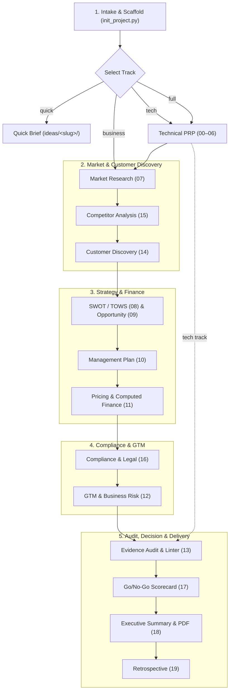

# BrainstormingAgent

**English** | [Bahasa Indonesia](README.id.md) | [简体中文](README.zh.md)

A structured, enterprise-grade workspace for an **AI Brainstorming Partner & Strategic Analysis Agent** compatible with **all major AI coding & agent tools** (**Claude Code**, **OpenAI Codex**, **Antigravity**, **Gemini CLI**, **Cursor**, **GitHub Copilot**, **OpenCode**) via `AGENTS.md`, `CLAUDE.md`, `GEMINI.md`, `.cursor/rules/`, `.github/copilot-instructions.md`, and `.agents/skills/`. Built to take raw ideas from initial exploration through business validation, technical PRP (*Project Requirements & Plan*), live market research, computed financial modeling, compliance checks, and print-ready editorial PDF reports—using **pure Python 3 stdlib** with zero external `pip` dependencies.

---

## Why Use BrainstormingAgent?

- **Right-Sized Engagement Tracks**: Avoid over-engineering. Triage every request into `quick` (1–2 page brief), `tech` (product/architecture PRP), `business` (commercial feasibility), or `full` (end-to-end) using `project-intake` and `scripts/init_project.py`.
- **Staged Pipeline with Checkpoints**: Work progresses step by step; the agent summarizes findings, runs a short red-team check, and waits for your approval before moving to the next stage.
- **Evidence Discipline & Automated Linter**: Every numeric claim is labeled `[Verified]`, `[Estimate]`, `[Assumption]`, or `[Unverified]`, sources are graded `A`/`B`/`C` with access dates, and `scripts/lint_project.py` automatically catches broken links, scorecard math errors, stale sources, and editorial slop.
- **Computed Financial Modeling (Transactional & SaaS)**: `model.py` computes 3 scenarios (pessimistic, base, optimistic), CAPEX, channel fees, taxes, exact cash runway, LTV/CAC, payback period, 2-way sensitivity matrices, and clean SVG cash curves—never prose guesses.
- **Editorial PDF Export with Mermaid**: `export_pdf.py` compiles single Markdown files or full PRP folders (`--mode executive|technical|full`) into A4 PDFs with cover styling, automatic Table of Contents, repeating table headers, embedded SVG charts, and Mermaid diagram rendering.

---

## Prerequisites & Quick Start

### Prerequisites
- **Any AI Agent / Coding CLI**:
  - **OpenAI Codex / Antigravity / OpenCode**: automatically reads `AGENTS.md` and `.agents/skills/`.
  - **Claude Code**: automatically reads `CLAUDE.md` (run `python3 scripts/install_skills.py --target claude` to mirror skills into `.claude/skills/` or `--scope global` for `~/.claude/skills/`).
  - **Gemini CLI**: automatically reads `GEMINI.md` (run `python3 scripts/install_skills.py --target gemini` to mirror into `.gemini/skills/`).
  - **Cursor & GitHub Copilot**: automatically reads `.cursor/rules/brainstorming-agent.mdc` and `.github/copilot-instructions.md`.
- **Python 3** (stdlib only; no `pip install` required).
- **Brave Browser, Google Chrome, or Chromium** (used headless by `export_pdf.py` to render PDFs; override path via `PDF_BROWSER` env var).

### Getting Started
1. Clone this repository:
   ```bash
   git clone https://github.com/AlulCode45/BrainstormingAgent.git
   cd BrainstormingAgent
   ```
2. Open the `BrainstormingAgent` folder in your preferred AI tool (or mirror skills for Claude/Gemini/Codex with `python3 scripts/install_skills.py --target all`).
3. Start a session by describing your idea or goal, for example:
   - *"Let's brainstorm a B2B SaaS idea for auto repair shops."*
   - *"Initialize a full feasibility project for this concept."*
   - *"Design pricing tiers and run a 12-month SaaS financial projection."*
   - *"Audit the evidence with lint_project.py and export an executive PDF."*

---

## Engagement Tracks & Staged Pipeline

| Track | Best For | Output Location |
|---|---|---|
| `quick` | Early exploration, 1–2 page structured note | `ideas/<slug>/YYYY-MM-DD-brief.md` |
| `tech` | Software/product specification & architecture | `prps/YYYY-MM-DD-<slug>/` (`00`–`06`, `13`, `17`) |
| `business` | Commercial & financial feasibility without code specs | `prps/YYYY-MM-DD-<slug>/` (`00`, `07`–`19`) |
| `full` | End-to-end product, business, finance, & compliance | `prps/YYYY-MM-DD-<slug>/` (`00`–`19`) |



---

## 20 Modular Skills (`.agents/skills/`)

### 1. Intake, Ideation & Product Scoping
| Skill | Purpose | Primary Output |
|---|---|---|
| `project-intake` | Triage track (`quick`/`tech`/`business`/`full`), capture constraints, scaffold folder | Project scaffold |
| `ideation-facilitator` | Divergent exploration (*First Principles*, *SCAMPER*, *HMW*, *3-Horizon*) | Structured options |
| `business-validator` | Rapid validation (*Lean Canvas*, ICP, experiments with Pass/Kill criteria) | Validation verdict |
| `project-scoper` | MVP scoping (*MoSCoW*), pragmatic architecture, and task breakdown | MVP scope & tasks |
| `prp-writer` | Detailed sequential PRP with Mermaid flows, architecture, & ERD | `prps/<project>/00`–`06` |
| `tech-feasibility-estimator` | Build-vs-buy, effort (man-days), infra/AI API COGS, & security baseline | Updates `03`, `06`, `inputs.json` |
| `idea-logger` | Archive brainstorming notes into topic folders | `ideas/<topic-slug>/` |

### 2. Market, Customers & Experiments
| Skill | Purpose | Primary Output |
|---|---|---|
| `market-researcher` | Top-Down + Bottom-Up TAM/SAM/SOM triangulation, trends, graded sources | `07-market-research.md` |
| `competitor-analyst` | Feature/price matrix, review mining, positioning map, & ERRC (*Blue Ocean*) | `15-competitor-analysis.md` |
| `customer-discovery` | *Mom Test* interview scripts, surveys, JTBD, & data-backed personas | `14-customer-discovery.md` |
| `experiment-designer` | Falsifiable Experiment Cards with pre-committed numeric Pass/Kill criteria | Experiment cards |

### 3. Strategy, Pricing, Finance & Compliance
| Skill | Purpose | Primary Output |
|---|---|---|
| `pricing-strategist` | Value metric, Good/Better/Best tiers, WTP, & channel margin waterfall | Pricing & model inputs |
| `strategy-analyst` | Staged SWOT/TOWS, PESTEL, Five Forces, ops/KPIs, GTM, & business risk register | `08`–`12` |
| `financial-modeler` | `transactional` & `saas` 3-scenario model, 2-way sensitivity, & SVG chart | `model/inputs.json` & `11` |
| `compliance-checker` | Licensing (OSS/NIB), permits (BPOM/Halal/PSE), tax, IP, & UU PDP checklist | `16-compliance-and-legal.md` |

### 4. Audit, Decision & Reporting
| Skill | Purpose | Primary Output |
|---|---|---|
| `devils-advocate` | Constructive stress-testing, 6-month pre-mortem, & risk mitigations | Critique & hedges |
| `evidence-auditor` | Source grading (`A`/`B`/`C`), `[Stale]` flagging, assumption register, & linter | `13-assumption-register.md` |
| `decision-scorecard` | Red-team check, 1–5 rubric, weighted Go/No-Go, weight sensitivity, & ADR | `17-scorecard-and-decision.md` |
| `executive-reporter` | 1-page summary, SVG charts, pitch/backlog outline, & editorial PDF export | `18-executive-summary.md` & PDF |
| `retrospective-tracker` | Actual vs forecast variance review, assumption updates, & pivot/scale ADR | `19-retrospective.md` |

---

## CLI Scripts & Tests

### 1. Initialize a Project (`init_project.py`)
```bash
python3 scripts/init_project.py --slug auto-shop-saas --title "Auto Shop SaaS" --track full --model-type saas
```

### 2. Run Financial Model (`model.py`)
```bash
python3 .agents/skills/financial-modeler/scripts/model.py \
  .agents/skills/financial-modeler/scripts/example_inputs.json \
  --months 12 --locale auto \
  --chart-out examples/sample-report/cash-projection.svg \
  --json-out /tmp/summary.json
```

### 3. Lint Project Quality Gates (`lint_project.py`)
```bash
python3 scripts/lint_project.py prps/<project-slug>
```

### 4. Export Report to PDF (`export_pdf.py`)
Single Markdown file with Table of Contents:
```bash
python3 .agents/skills/executive-reporter/scripts/export_pdf.py \
  --input examples/sample-report/sample-executive-report.md \
  --output examples/sample-report/sample-executive-report.pdf \
  --title "Sample Business Analysis Report" --toc
```
Full PRP project folder (`--mode executive | technical | full`):
```bash
python3 .agents/skills/executive-reporter/scripts/export_pdf.py \
  --project prps/<project-slug> --mode executive \
  --output prps/<project-slug>/assets/<project-slug>-report.pdf \
  --title "Project Name"
```
See the sample output at [examples/sample-report/sample-executive-report.pdf](examples/sample-report/sample-executive-report.pdf).

### 5. Run Unit & Integration Tests
```bash
python3 -m unittest discover -s tests -v
```

---

## Directory Structure

```text
BrainstormingAgent/
├── AGENTS.md                           # Core agent rules, tracks, quality gates, & Git privacy
├── README.md / README.id.md / README.zh.md
├── LICENSE
├── scripts/
│   ├── init_project.py                 # Deterministic project/brief scaffolding
│   └── lint_project.py                 # Links, scorecard math, evidence tags, & anti-slop linter
├── tests/                              # Python unittest suite
├── .agents/skills/                     # 20 modular skills (SKILL.md + scripts/)
├── templates/                          # Standardized templates (scorecard, ADR, experiment, etc.)
├── examples/sample-report/             # Sample report, generated SVG chart, & PDF
├── ideas/                              # Local brainstorming briefs (grouped by topic)
└── prps/                               # Local PRP & feasibility folders + INDEX.md
```

---

## Git & Data Privacy Rules

- **Tooling** (`.agents/skills/`, `scripts/`, `templates/`, `tests/`, `examples/`, `AGENTS.md`, `README*.md`): commit and push to `origin` (`main`).
- **Project & Client Data** (`prps/` and `ideas/`): kept local by default. **Never** push `prps/` or `ideas/` to a public `origin` without explicit user confirmation.

---

## License

See [LICENSE](LICENSE) for usage and distribution details.
