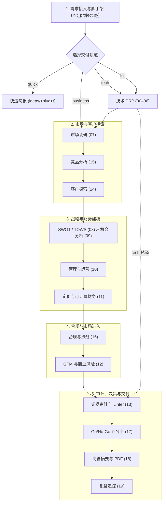

<p align="center">
  
</p>

# IdeaForge

[English](README.md) | [Bahasa Indonesia](README.id.md) | **简体中文**

一个结构化、企业级的 **AI 头脑风暴伙伴与战略分析智能体（Strategic Analysis Agent）** 工作区，全面兼容 **主流 AI 编程与智能体工具**（**Claude Code**、**OpenAI Codex**、**Antigravity**、**Gemini CLI**、**Cursor**、**GitHub Copilot**、**OpenCode**），通过 `AGENTS.md`、`CLAUDE.md`、`GEMINI.md`、`.cursor/rules/`、`.github/copilot-instructions.md` 与 `.agents/skills/` 统一接入。旨在将原始想法系统化推进至商业验证、技术需求规划（PRP）、实时市场调研、可计算财务建模、合规核查及出版级 PDF 报告导出——全程仅依赖 **Python 3 标准库**，无需任何外部 `pip` 依赖。

---

## 核心优势

- **按需分级的交付轨道（Engagement Tracks）**：拒绝千篇一律。通过 `project-intake` 与 `scripts/init_project.py`，将需求精准分流为 `quick`（1–2 页简报）、`tech`（产品/架构 PRP）、`business`（商业可行性分析）或 `full`（全链路）。
- **分阶段推进与人工确认节点（Checkpoints）**：每个阶段完成后自动总结核心发现、执行简短的红队压力测试（Red-team），并在获得您的确认后才进入下一阶段。
- **证据分级与自动化质量检查（Linter）**：所有数据强制标注 `[Verified]`、`[Estimate]`、`[Assumption]` 或 `[Unverified]`，来源标注 `A`/`B`/`C` 评级与访问日期；`scripts/lint_project.py` 自动校验相对链接、评分卡算术、过期引用与文案质量。
- **可计算财务模型（支持交易型与 SaaS 模式）**：`model.py` 自动计算悲观/基准/乐观三情景、CAPEX、渠道费率、税率、精确现金跑道（Runway）、LTV/CAC、回本周期、双向敏感性矩阵，并生成 SVG 现金流曲线图。
- **排版级 PDF 导出与 Mermaid 支持**：`export_pdf.py` 支持将单篇 Markdown 或完整 PRP 文件夹（`--mode executive|technical|full`）导出为 A4 PDF，自动生成封面与目录（TOC）、跨页重复表头、SVG 图表及 Mermaid 流程图。

---

## 环境要求与快速开始

### 环境要求
- **任意 AI 智能体 / 编程 CLI 工具**：
  - **OpenAI Codex / Antigravity / OpenCode**：自动读取 `AGENTS.md` 与 `.agents/skills/`。
  - **Claude Code**：自动读取 `CLAUDE.md`（运行 `python3 scripts/install_skills.py --target claude` 可将技能同步至 `.claude/skills/`，加 `--scope global` 可安装至 `~/.claude/skills/`）。
  - **Gemini CLI**：自动读取 `GEMINI.md`（运行 `python3 scripts/install_skills.py --target gemini` 可同步至 `.gemini/skills/`）。
  - **Cursor & GitHub Copilot**：自动读取 `.cursor/rules/ideaforge.mdc` 与 `.github/copilot-instructions.md`。
- **Python 3**（仅需标准库，无需 `pip install`）。
- **Brave Browser / Google Chrome / Chromium**（供 `export_pdf.py` 以无头模式渲染 PDF；可通过 `PDF_BROWSER` 环境变量指定路径）。

### 快速上手
1. 克隆本仓库：
   ```bash
   git clone https://github.com/AlulCode45/IdeaForge.git
   cd IdeaForge
   ```
2. 在您偏好的 AI 工具中打开 `IdeaForge` 文件夹（如需同步技能至 Claude/Gemini/Codex，可运行 `python3 scripts/install_skills.py --target all`）。
3. 直接描述您的想法或目标即可开始，例如：
   - *“我想头脑风暴一个面向汽修店的 B2B SaaS 方案。”*
   - *“为这个项目初始化一个完整的 full 可行性分析工作区。”*
   - *“设计定价分层并运行 12 个月的 SaaS 财务预测。”*
   - *“用 lint_project.py 审计项目证据并导出高管报告 PDF。”*

---

## 交付轨道与阶段流程（Pipeline）

| 轨道 | 适用场景 | 输出位置 |
|---|---|---|
| `quick` | 早期灵感探索、1–2 页结构化简报 | `ideas/<slug>/YYYY-MM-DD-brief.md` |
| `tech` | 软件产品需求与系统架构设计 | `prps/YYYY-MM-DD-<slug>/`（`00`–`06`, `13`, `17`） |
| `business` | 商业与财务可行性评估（不含深层技术规格） | `prps/YYYY-MM-DD-<slug>/`（`00`, `07`–`19`） |
| `full` | 端到端产品 + 商业 + 财务 + 合规全套分析 | `prps/YYYY-MM-DD-<slug>/`（`00`–`19`） |



---

## 20 个模块化技能（`.agents/skills/`）

### 1. 需求接入、创意发散与产品规划
| 技能 | 核心职责 | 主要输出 |
|---|---|---|
| `project-intake` | 分流轨道（`quick`/`tech`/`business`/`full`）、确认约束并初始化目录 | 项目脚手架 |
| `ideation-facilitator` | 结构化发散思维（第一性原理、SCAMPER、HMW、三地平线） | 创意方向与选项 |
| `business-validator` | 快速商业验证（精益画布、ICP、含通过/淘汰标准的实验设计） | 验证结论 |
| `project-scoper` | MVP 范围界定（MoSCoW）、务实架构与任务拆解 | MVP 清单与任务 |
| `prp-writer` | 编写分章节的详细 PRP，含 Mermaid 流程图、架构图与 ERD | `prps/<project>/00`–`06` |
| `tech-feasibility-estimator` | 自研与采购评估、人天工作量估算、云/AI API 成本及安全基线 | 更新 `03`、`06`、`inputs.json` |
| `idea-logger` | 将头脑风暴纪要按主题归档至 `ideas/` | `ideas/<topic-slug>/` |

### 2. 市场、客户与验证实验
| 技能 | 核心职责 | 主要输出 |
|---|---|---|
| `market-researcher` | 自上而下 + 自下而上交叉验证 TAM/SAM/SOM，引用带评级来源 | `07-market-research.md` |
| `competitor-analyst` | 功能价格矩阵、公开评论挖掘、定位图与 ERRC 蓝海机会 | `15-competitor-analysis.md` |
| `customer-discovery` | Mom Test 访谈提纲、问卷设计、JTBD 与数据支撑的用户画像 | `14-customer-discovery.md` |
| `experiment-designer` | 含预设量化 Pass/Kill 标准的实验卡片与 1–4 周验证排期 | 实验卡片 |

### 3. 战略、定价、财务与合规
| 技能 | 核心职责 | 主要输出 |
|---|---|---|
| `pricing-strategist` | 价值指标、高中低套餐、WTP 测试与渠道利润瀑布模型 | 定价方案与模型参数 |
| `strategy-analyst` | 分阶段 SWOT/TOWS、PESTEL、五力模型、运营 KPI、GTM 与商业风险 | `08`–`12` |
| `financial-modeler` | `transactional` / `saas` 三情景预测、双向敏感性与 SVG 图表 | `model/inputs.json` & `11` |
| `compliance-checker` | 营业执照、行业许可、税务、知识产权与个人数据保护清单 | `16-compliance-and-legal.md` |

### 4. 审计、决策与交付报告
| 技能 | 核心职责 | 主要输出 |
|---|---|---|
| `devils-advocate` | 建设性压力测试、6 个月事前验尸（Pre-mortem）与风险对冲 | 质疑与缓解方案 |
| `evidence-auditor` | 来源评级（`A`/`B`/`C`）、过期标注 `[Stale]`、假设台账与 Linter 检查 | `13-assumption-register.md` |
| `decision-scorecard` | 自动红队复核、1–5 分制评分标准、加权 Go/No-Go 与 ADR 决策记录 | `17-scorecard-and-decision.md` |
| `executive-reporter` | 一页纸高管摘要、SVG 图表、路演/任务导出大纲与 PDF 导出 | `18-executive-summary.md` & PDF |
| `retrospective-tracker` | 上线/实验后实际值与预测值偏差对比、更新假设台账与转型决策 | `19-retrospective.md` |

---

## 命令行工具与测试

### 1. 初始化项目（`init_project.py`）
```bash
python3 scripts/init_project.py --slug auto-shop-saas --title "汽修店 SaaS" --track full --model-type saas
```

### 2. 运行财务模型（`model.py`）
```bash
python3 .agents/skills/financial-modeler/scripts/model.py \
  .agents/skills/financial-modeler/scripts/example_inputs.json \
  --months 12 --locale auto \
  --chart-out examples/sample-report/cash-projection.svg \
  --json-out /tmp/summary.json
```

### 3. 自动化质量审计（`lint_project.py`）
```bash
python3 scripts/lint_project.py prps/<project-slug>
```

### 4. 导出 PDF 报告（`export_pdf.py`）
导出单篇 Markdown 并生成目录：
```bash
python3 .agents/skills/executive-reporter/scripts/export_pdf.py \
  --input examples/sample-report/sample-executive-report.md \
  --output examples/sample-report/sample-executive-report.pdf \
  --title "商业分析报告示例" --toc
```
或按模式（`executive`、`technical`、`full`）导出整个 PRP 项目文件夹：
```bash
python3 .agents/skills/executive-reporter/scripts/export_pdf.py \
  --project prps/<project-slug> --mode executive \
  --output prps/<project-slug>/assets/<project-slug>-report.pdf \
  --title "项目名称"
```
示例报告效果请查看 [examples/sample-report/sample-executive-report.pdf](examples/sample-report/sample-executive-report.pdf)。

### 5. 运行单元测试与集成测试
```bash
python3 -m unittest discover -s tests -v
```

---

## 目录结构

```text
IdeaForge/
├── AGENTS.md                           # 核心智能体规范、交付轨道、质量门禁与 Git 隐私规则
├── README.md / README.id.md / README.zh.md
├── LICENSE
├── scripts/
│   ├── init_project.py                 # 项目/简报脚手架生成脚本
│   └── lint_project.py                 # 链接、评分卡算术、证据标签与反空话检查器
├── tests/                              # Python unittest 测试套件
├── .agents/skills/                     # 20 个模块化技能（SKILL.md + scripts/）
├── templates/                          # 标准化文档模板（评分卡、ADR、实验卡等）
├── examples/sample-report/             # 示例报告、自动生成的 SVG 图表与 PDF
├── ideas/                              # 本地头脑风暴简报（按主题分目录）
└── prps/                               # 本地 PRP 与可行性分析目录 + INDEX.md
```

---

## Git 与数据隐私规范

- **工具链文件**（`.agents/skills/`、`scripts/`、`templates/`、`tests/`、`examples/`、`AGENTS.md`、`README*.md`）：提交并推送至 `origin`（`main`）。
- **项目与客户数据**（`prps/` 与 `ideas/`）：默认仅保留在本地。未经用户明确确认，**切勿**将 `prps/` 或 `ideas/` 推送至公开远程仓库。

---

## 开源协议

使用与分发条款请参见 [LICENSE](LICENSE)。
