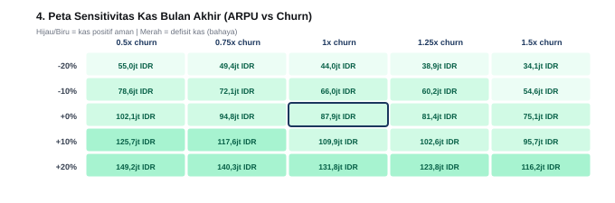

# Financial Plan - BengkelKu SaaS (Sample)

Figures computed by `financial-modeler/scripts/model.py` from [inputs.json](model/inputs.json) (`saas` mode, IDR 75,000,000 starting cash, IDR 12,000,000 CAPEX, IDR 8,500,000/mo fixed costs, IDR 199,000/mo ARPU, IDR 22,000/shop infra/WA COGS, 2.5% channel fee, 0.5% UMKM tax, 4.5%/mo base churn).

<!-- kpi-grid -->
Starting Cash | IDR 75.0M | Includes IDR 12.0M CAPEX |
Break-Even (Base) | Month 7 | 204 active shops at M12 | good
Unit Economics | LTV/CAC 13.7x | 86.4% Margin · 1.6 mo Payback | good
Lowest Cash (Base) | IDR 34.8M | Positive across all scenarios | good
<!-- /kpi-grid -->

## 3-Scenario Summary (12 Months)

| Scenario | M12 Active Users | M12 MRR (IDR) | Break-Even | Lowest Cash (IDR) | Month-12 Cash (IDR) |
|---|---|---|---|---|---|
| Pessimistic (0.65x acq, 1.35x churn) | 92 | 18,318,323 | Month 11 | 14,277,861 | 17,596,956 [Estimate] |
| Base (1.0x) | 204 | 40,619,647 | Month 7 | 34,770,101 | 87,918,180 [Estimate] |
| Optimistic (1.3x acq, 0.75x churn) | 335 | 66,659,838 | Month 5 | 40,878,091 | 157,282,180 [Estimate] |

## Financial & Sensitivity Visualizations (ARPU vs Churn)

> **Critical Note**: All 3 scenarios maintain a positive cash balance (lowest point IDR 14.28M in the pessimistic case), but this resilience depends on keeping monthly churn <= 6.1% and initial CAPEX <= IDR 12M.
