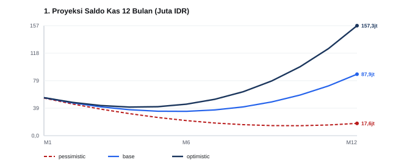
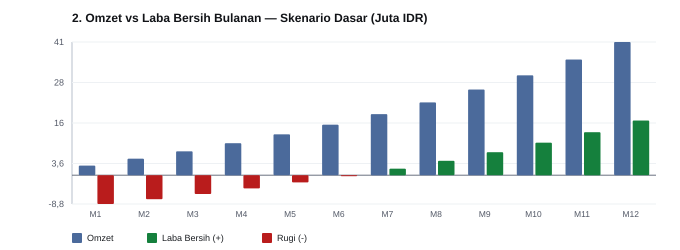
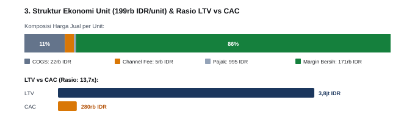

# Rencana Keuangan - BengkelKu SaaS (Sample)

Angka dihitung oleh `financial-modeler/scripts/model.py` dari [inputs.json](model/inputs.json) (mode `saas`, modal awal IDR 75.000.000, CAPEX IDR 12.000.000, biaya tetap IDR 8.500.000/bulan, ARPU IDR 199.000/bulan, COGS infra/WA IDR 22.000/bengkel, *channel fee* 2,5%, PPh UMKM 0,5%, *churn* dasar 4,5%/bulan).

<!-- kpi-grid -->
Modal Awal | IDR 75,0 jt | Termasuk CAPEX 12,0 jt |
Break-Even (Base) | Month 7 | 204 bengkel aktif di M12 | good
Ekonomi Unit | LTV/CAC 13,7x | Margin 86,4% · Payback 1,6 bln | good
Kas Terendah (Base) | IDR 34,8 jt | Aman di semua skenario | good
<!-- /kpi-grid -->

## Ringkasan 3 Skenario (12 Bulan)

| Skenario | Active Users M12 | MRR Bulan 12 (IDR) | Break-Even | Kas Terendah (IDR) | Kas Bulan 12 (IDR) |
|---|---|---|---|---|---|
| Pessimistic (0.65x acq, 1.35x churn) | 92 | 18.318.323 | Month 11 | 14.277.861 | 17.596.956 [Estimate] |
| Base (1.0x) | 204 | 40.619.647 | Month 7 | 34.770.101 | 87.918.180 [Estimate] |
| Optimistic (1.3x acq, 0.75x churn) | 335 | 66.659.838 | Month 5 | 40.878.091 | 157.282.180 [Estimate] |

## Visualisasi Keuangan & Sensitivitas (ARPU vs Churn)

> **Catatan Kritis**: Seluruh 3 skenario tetap memiliki saldo kas positif (terendah IDR 14,28 juta di skenario pesimis), namun ketahanan ini bergantung pada *monthly churn* <= 6,1% dan CAPEX awal tidak melebihi IDR 12 juta.
