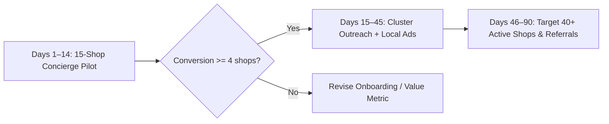

# Go-to-Market & Business Risks - BengkelKu SaaS (Sample)

## 1. First 90-Day Execution Flow

## 2. Business Risk Register

| Risk | Likelihood | Impact | Mitigation |
|---|---|---|---|
| Monthly churn > 6% due to tedious inventory setup | High | High | Pre-load top 100 popular spare parts & 30-min guided onboarding |
| Field acquisition CAC exceeds IDR 280,000/shop | Medium | Medium | "Free 1-month" referral program for workshops referring peers |
| WhatsApp gateway downtime | Low | High | Implement retry queue + email/in-app notification fallback |
