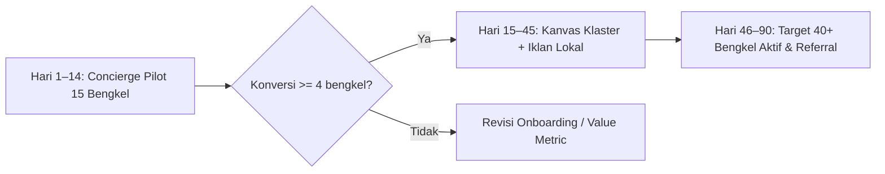

# Go-to-Market & Risiko Bisnis - BengkelKu SaaS (Sample)

## 1. Alur Eksekusi 90 Hari Pertama

## 2. Register Risiko Bisnis

| Risiko | Kemungkinan | Dampak | Mitigasi |
|---|---|---|---|
| *Churn* > 6%/bulan karena malas input stok | Tinggi | Tinggi | Pre-load katalog 100 sparepart populer & sesi onboarding 30 menit |
| CAC lapangan > IDR 280.000/bengkel | Sedang | Sedang | Program referral "Gratis 1 bulan" untuk bengkel yang mereferensikan rekan |
| Gangguan integrasi WhatsApp gateway | Rendah | Tinggi | Sediakan antrean retry + fallback notif via email/in-app |
