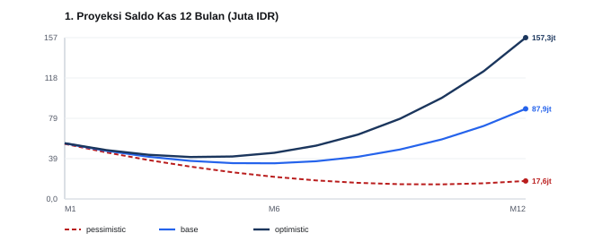
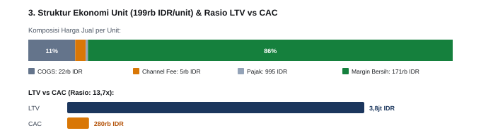

# Executive Summary - BengkelKu SaaS (Sample)

Date: 2026-11-22 | Version: v1.0 | Track: business | Currency: IDR | Confidentiality: Client-ready (Sample) | Decision status: Conditional

**Recommendation**: Proceed to a **14-day Concierge Pilot with 15 motorcycle workshops** using a 14-day free trial (not permanent freemium). In the base scenario, monthly break-even is reached in Month 7 and cash remains positive across all three scenarios.

<!-- kpi-grid -->
Decision Score | 3.90 / 5.0 | Go with conditions | good
Break-Even (Base) | Month 7 | 204 active shops at M12 | good
Unit Economics | LTV/CAC 13.7x | 86.4% Margin · 1.6 mo Payback | good
Validation Focus | Churn <= 4.5% | Primary 14-day pilot gate | warn
<!-- /kpi-grid -->

| Section | Summary | Evidence Status |
|---|---|---|
| Problem | SME motorcycle workshops lose margin due to manual part & commission tracking | [Assumption] |
| Solution | Vertical workshop POS + mechanic commissions + WhatsApp reminders (IDR 199k/mo) | [Assumption] |
| Target market and size | SAM 30,000 urban shops (~IDR 71.6B/yr); Year-1 SOM ~IDR 487M ARR | [Estimate] |
| Evidence quality | Illustrative sample case; requires 15-workshop field pilot | [Unverified] |
| Economics | ARPU IDR 199,000, 86.4% margin, Month-7 BEP, Month-12 cash IDR 87.9M | [Estimate] |
| Top 3 risks and mitigations | High churn (pre-load parts); high CAC (referral); WA gateway (retry queue) | [Estimate] |
| Compliance blockers | NIB/PT Perorangan, Komdigi PSE registration, UU PDP privacy policy | [Estimate] |
| Next 30-day actions | 1) Build part-catalog MVP; 2) Run 15-shop pilot; 3) Update `inputs.json` | [Assumption] |

Links: [scorecard](17-scorecard-and-decision.md), [assumptions](13-assumption-register.md), [financials](11-financial-plan.md).
