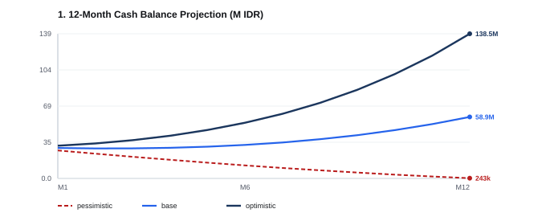

> **Catatan**: Dokumen ini adalah contoh format laporan akhir (*sample*) untuk menilai tata letak, tipografi, tabel, grafik SVG otomatis, dan diagram alur PDF. Angka di bawah dihitung langsung oleh `financial-modeler/scripts/model.py` dari `example_inputs.json`.

## 1. Ringkasan Eksekutif

**Rekomendasi**: Lanjutkan ke fase uji pasar terbatas (30 hari) dengan modal awal IDR 35.000.000 (termasuk CAPEX IDR 5.000.000). Pada skenario dasar, titik impas tercapai di Bulan ke-3 dan kas tetap positif di semua skenario, dengan syarat *channel fee* dijaga di bawah 5% dan *repeat order* minimal 2,0x.

| Aspek | Ringkasan | Status Bukti |
|---|---|---|
| Masalah | Konsumen membutuhkan produk dengan harga transparan dan pemesanan ulang yang cepat | [Contoh] |
| Solusi | Penjualan langsung dengan sistem langganan/repeat order bulanan | [Contoh] |
| Harga & Margin | Harga IDR 150.000/unit, COGS IDR 60.000/unit, *channel fee* 5%, margin kontribusi 55,0% | [Estimate] |
| Ekonomi Unit | LTV IDR 165.000, CAC IDR 25.000, rasio LTV/CAC 6,6x, *payback* 0,2 bulan | [Estimate] |
| Titik Impas | Bulan ke-3 pada skenario dasar; belum tercapai dalam 12 bulan pada skenario pesimis | [Estimate] |
| Keputusan | Go dengan syarat (Skor: 3,75 / 5,0) | [Contoh] |

## 2. Alur Validasi 30 Hari

## 3. Skor Keputusan (Go / No-Go Scorecard)

| Kriteria | Bobot | Skor (1-5) | Nilai Terbobot | Dasar Penilaian |
|---|---|---|---|---|
| Permintaan Pasar | 20% | 4 | 0,80 | Sinyal permintaan stabil pada segmen target |
| Kualitas Bukti | 15% | 3 | 0,45 | Sebagian asumsi biaya akuisisi belum diuji lapangan |
| Ekonomi Unit | 20% | 4 | 0,80 | Margin kontribusi 55,0% dan LTV/CAC 6,6x |
| Kelayakan Eksekusi | 15% | 4 | 0,60 | Operasional dapat dijalankan tim kecil pada tahap awal |
| Keunggulan Kompetitif | 10% | 3 | 0,30 | Diferensiasi masih bergantung pada eksekusi layanan |
| Risiko & Kepatuhan | 10% | 4 | 0,40 | Perizinan dasar dan kewajiban PPh UMKM 0,5% terpetakan |
| Kesiapan Tim | 10% | 4 | 0,40 | Kapasitas tim mencukupi untuk target 90 hari pertama |
| **Total Skor** | **100%** | | **3,75 / 5,0** | **Go dengan syarat** |

## 4. Proyeksi Keuangan (12 Bulan)

Data dihitung oleh `model.py` dengan modal awal IDR 35.000.000, CAPEX awal IDR 5.000.000, biaya tetap IDR 5.000.000/bulan, *channel fee* 5%, PPh UMKM 0,5%, pertumbuhan 10%/bulan, dan *repeat order* 2,0x.

| Skenario | Unit Bulan 1 | Break-Even | Kas Terendah (IDR) | Kas Bulan 12 (IDR) | Runway |
|---|---|---|---|---|---|
| Pesimis | 36 | Belum tercapai | 243.297 | 243.297 | 12,2 bulan |
| Dasar | 60 | Bulan ke-3 | 28.725.500 | 58.851.699 | >12 bulan |
| Optimis | 84 | Bulan ke-1 | 31.319.000 | 138.506.174 | >12 bulan |

### Uji Sensitivitas 2-Arah (Skenario Dasar, Kas Bulan ke-12: Harga vs Volume)

| Perubahan Harga \ Volume | 0.7x vol | 0.85x vol | 1x vol | 1.15x vol | 1.3x vol |
|---|---|---|---|---|---|
| -20% | 6.733.923 | 14.605.478 | 22.477.032 | 30.348.587 | 38.220.142 |
| -10% | 19.465.056 | 30.064.711 | 40.664.366 | 51.264.021 | 61.863.675 |
| +0% | 32.196.189 | 45.523.944 | 58.851.699 | 72.179.454 | 85.507.209 |
| +10% | 44.927.323 | 60.983.178 | 77.039.032 | 93.094.887 | 109.150.742 |
| +20% | 57.658.456 | 76.442.411 | 95.226.366 | 114.010.321 | 132.794.275 |

## 5. Risiko Utama & Rencana 30 Hari Pertama

| Risiko | Dampak | Mitigasi |
|---|---|---|
| Volume penjualan di bawah skenario dasar | Cadangan kas menipis hingga IDR 243.297 di bulan ke-12 | Terapkan sistem pre-order sebelum produksi massal |
| CAC aktual lebih tinggi dari IDR 25.000 | Rasio LTV/CAC turun | Fokus pada kanal organik dan rujukan pelanggan awal |
| Asumsi repeat order 2,0x tidak tercapai | Biaya akuisisi per unit naik 2x lipat | Lakukan wawancara 10 pembeli pertama di minggu ke-3 |

### Langkah Konkret 30 Hari Pertama

- [ ] Minggu 1: Wawancara 10 calon pelanggan untuk menguji asumsi harga IDR 150.000.
- [ ] Minggu 2: Uji penjualan batch kecil (20 unit) untuk mengukur CAC aktual.
- [ ] Minggu 3: Evaluasi margin bersih dan perbarui `inputs.json` dengan data nyata.
- [ ] Minggu 4: Keputusan lanjut ke skala penuh atau penyesuaian harga.
