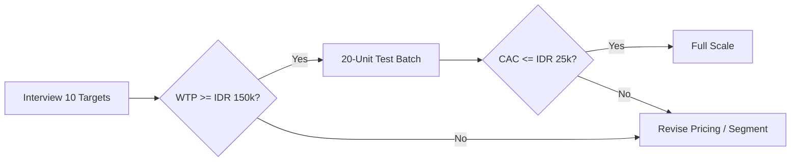

> **Note**: This document is a sample executive report format for evaluating layout, typography, tables, SVG charts, and Mermaid diagrams. Figures below are computed directly by `financial-modeler/scripts/model.py` from `example_inputs.json`.

## 1. Executive Summary

**Recommendation**: Proceed to a 30-day limited market test with IDR 35,000,000 starting cash (including IDR 5,000,000 CAPEX). In the base scenario, break-even is reached in Month 3 and cash stays positive across all scenarios, provided channel fees remain <= 5% and repeat orders reach >= 2.0x.

<!-- kpi-grid -->
Decision Score | 3.75 / 5.0 | Conditional Go | good
Break-Even (Base) | Month 3 | Month-12 Cash: IDR 58.9M | good
Unit Economics | LTV/CAC 6.6x | Gross Margin 55.0% | good
Lowest Cash (Pess.) | IDR 243k | Tight buffer at Month 12 | warn
<!-- /kpi-grid -->

| Aspect | Summary | Evidence Status |
|---|---|---|
| Problem | Customers need transparent pricing and fast repeat ordering | [Contoh] |
| Solution | Direct sales with monthly subscription / repeat-order workflow | [Contoh] |
| Price & Margin | Price IDR 150,000/unit, COGS IDR 60,000/unit, 5% channel fee, 55.0% contribution margin | [Estimate] |
| Unit Economics | LTV IDR 165,000, CAC IDR 25,000, LTV/CAC 6.6x, payback 0.2 months | [Estimate] |
| Break-Even | Month 3 in base scenario; not reached within 12 months in pessimistic scenario | [Estimate] |
| Decision | Go with conditions (Score: 3.75 / 5.0) | [Contoh] |

## 2. 30-Day Validation Workflow

## 3. Go / No-Go Scorecard

| Criterion | Weight | Score (1-5) | Weighted | Rationale |
|---|---|---|---|---|
| Market demand | 20% | 4 | 0.80 | Stable demand signals in target segment |
| Evidence quality | 15% | 3 | 0.45 | Acquisition cost assumptions not yet field-tested |
| Unit economics | 20% | 4 | 0.80 | 55.0% contribution margin and 6.6x LTV/CAC |
| Feasibility | 15% | 4 | 0.60 | Operations manageable by a lean team |
| Competitive edge | 10% | 3 | 0.30 | Differentiation relies on service execution |
| Risk & compliance | 10% | 4 | 0.40 | Basic permits and 0.5% UMKM tax mapped |
| Team readiness | 10% | 4 | 0.40 | Team capacity covers first 90-day milestones |
| **Total Score** | **100%** | | **3.75 / 5.0** | **Go with conditions** |

## 4. Financial Projections (12 Months)

Computed by `model.py` with IDR 35,000,000 starting cash, IDR 5,000,000 CAPEX, IDR 5,000,000/month fixed costs, 5% channel fee, 0.5% UMKM tax, 10%/month growth, and 2.0x repeat orders.

| Scenario | Month-1 Units | Break-Even | Lowest Cash (IDR) | Month-12 Cash (IDR) | Runway |
|---|---|---|---|---|---|
| Pessimistic | 36 | Not within 12 mo | 243,297 | 243,297 | 12.2 months |
| Base | 60 | Month 3 | 28,725,500 | 58,851,699 | >12 months |
| Optimistic | 84 | Month 1 | 31,319,000 | 138,506,174 | >12 months |

### 2-Way Sensitivity (Base Scenario, Month-12 Cash: Price vs Volume)

| Price \ Volume | 0.7x vol | 0.85x vol | 1x vol | 1.15x vol | 1.3x vol |
|---|---|---|---|---|---|
| -20% | 6,733,923 | 14,605,478 | 22,477,032 | 30,348,587 | 38,220,142 |
| -10% | 19,465,056 | 30,064,711 | 40,664,366 | 51,264,021 | 61,863,675 |
| +0% | 32,196,189 | 45,523,944 | 58,851,699 | 72,179,454 | 85,507,209 |
| +10% | 44,927,323 | 60,983,178 | 77,039,032 | 93,094,887 | 109,150,742 |
| +20% | 57,658,456 | 76,442,411 | 95,226,366 | 114,010,321 | 132,794,275 |

## 5. Top Risks & First 30-Day Plan

| Risk | Impact | Mitigation |
|---|---|---|
| Sales volume below base case | Cash buffer drops to IDR 243,297 by Month 12 | Use pre-order batching before bulk production |
| Actual CAC exceeds IDR 25,000 | LTV/CAC ratio compresses | Focus on organic and early customer referral channels |
| 2.0x repeat-order assumption misses | Effective acquisition cost per unit doubles | Interview first 10 buyers in Week 3 |

### Concrete First 30-Day Actions

- [ ] Week 1: Interview 10 target customers to test IDR 150,000 price willingness.
- [ ] Week 2: Run a 20-unit pilot batch to measure actual CAC.
- [ ] Week 3: Audit net margin and update `inputs.json` with observed data.
- [ ] Week 4: Decide whether to scale or adjust pricing.
