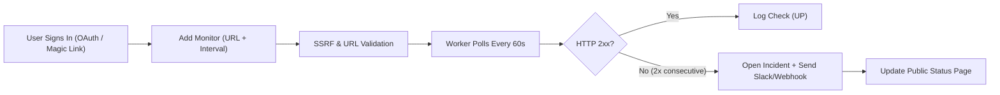

# 01. Users & Flows — DevPulse

## Personas
1. **Indie SaaS Founder (Alex)**: Wants a 2-minute setup to monitor API + landing page and share a clean public status page with customers.
2. **Ops / Backend Engineer (Maya)**: Needs reliable webhook payloads, zero false-positive Slack noise, and 90-day uptime history.

## Primary User & Alerting Flow

