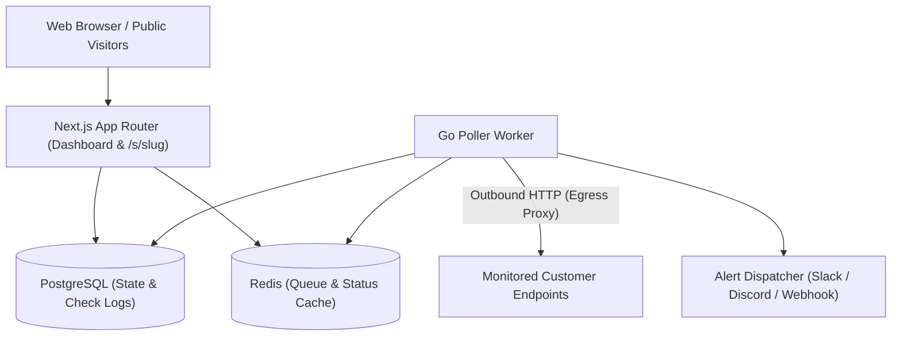

# 03. System Architecture & Feasibility — DevPulse

## 1. System Architecture

## 2. Build vs Buy Triage

| Capability | Decision | Rationale |
|---|---|---|
| Auth & Sessions | **Reuse** (Auth.js / Clerk) | Avoids hand-rolling OAuth & session rotation (~3 days saved) |
| Poller Worker | **Build** (Go goroutines) | Core product IP; Go handles 1,000+ concurrent checks on 512MB RAM |
| Database & Cache | **Buy** (Managed Postgres + Redis) | Zero ops overhead for backups and point-in-time recovery |
| Email / Alerts | **Buy** (Resend / Postmark) | High deliverability for magic links and email alerts |

## 3. Effort & Infra COGS Estimate (`tech-feasibility-estimator`)

- **MVP Engineering Effort**: 15 days base + 25% QA/integration buffer = **18–23 man-days** [Estimate].
- **Monthly Fixed Infra (MVP up to 1,000 monitors)**: App + Go Worker (`USD 12`), Managed Postgres (`USD 10`), Redis + Email (`USD 3`) = **~USD 25/month** [Estimate].
- **Unit Variable Tech Cost**: ~USD 0.02/monitor/month (bandwidth + check log storage) [Estimate].
