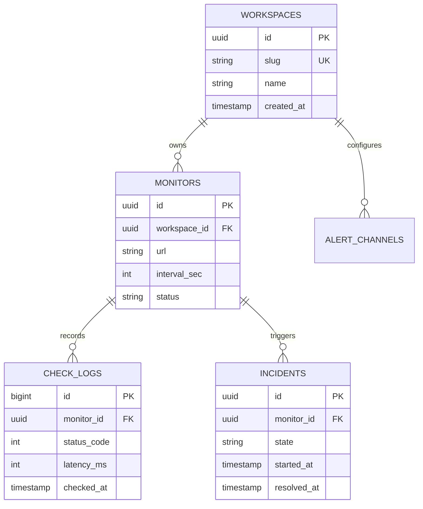

# 04. Data Model & Schema — DevPulse

## Entity-Relationship Diagram

## Storage & Retention Policy
- Retain raw `check_logs` for 30 days, and roll up daily uptime percentages into `daily_uptime_stats` for the 90-day public status bar [Estimate].
- Partition `check_logs` monthly by `checked_at` to keep index size bounded.
