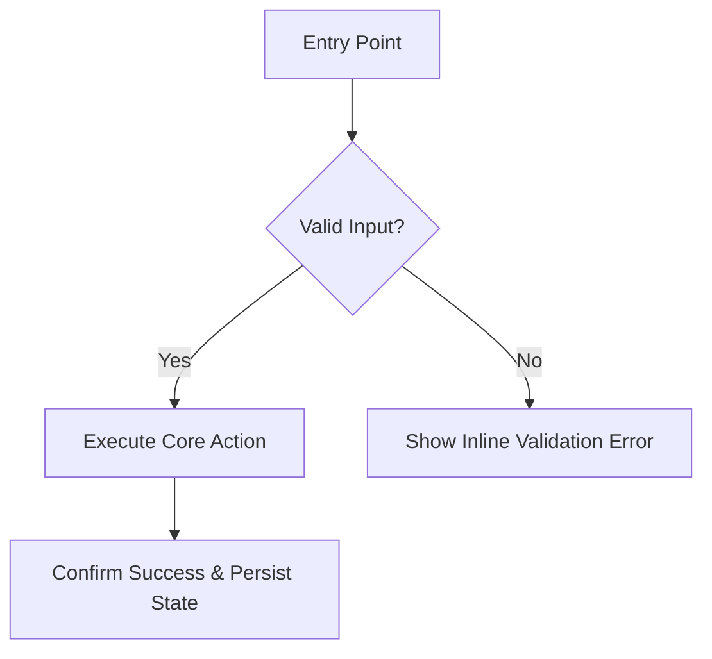

# Product Requirements Document (PRD) - <Project>

Date: YYYY-MM-DD | Version: v0.1 | Status: Draft | Owner: <PM / Founder> | Target Release: <MVP / v1.0> | Track: prd | Confidentiality: Local-only

**Recommendation**: Build `<Project>` for `<Primary Persona>` to solve `<Core Pain>`, shipping P0 scope first with measurable guardrail metrics before expanding to P1.

<!-- kpi-grid -->
Target Release | <MVP / v1.0> | <Target date or sprint> |
Primary Metric | <North Star KPI> | <Baseline -> Target> | good
P0 Scope | <N FRs / M Stories> | Strict out-of-scope enforced |
Top Risk | <Key Risk> | <Mitigation / Rollback trigger> | warn
<!-- /kpi-grid -->

## 1. Problem Statement & Context

Describe the concrete user pain, business context, and why solving this now matters. Tag all numeric claims with `[Verified]`, `[Estimate]`, `[Assumption]`, or `[Unverified]`.

- **Current Pain**: <What fails or wastes time today> `[Assumption]`
- **Affected Users**: <Target segment and estimated size/frequency> `[Assumption]`
- **Evidence / Links**: Link to customer discovery, market research, or support tickets (see [Assumption Register](13-assumption-register.md)).

## 2. Goals, Non-Goals & Success Metrics

### Goals
- **G-01**: <Primary user outcome to achieve>
- **G-02**: <Primary business or operational outcome to achieve>

### Non-Goals (Out of Scope)
- **NG-01**: <Explicitly excluded capability for this release to prevent scope creep>
- **NG-02**: <Deferred integration or secondary persona>

### Success Metrics & Guardrails

| Metric Type | Metric Name | Baseline | Target | Measurement Source | Evidence Tag |
|---|---|---|---|---|---|
| North Star | <Core value metric> | <Current> | <Target in 30/90d> | Analytics event | `[Assumption]` |
| Primary KPI | <Activation / conversion rate> | <Current> | <Target %> | Product telemetry | `[Assumption]` |
| Guardrail | <API p95 latency / error rate> | <Current> | `< 300ms / < 0.5%` | Monitoring | `[Estimate]` |

## 3. Target Users, Personas & Jobs-to-be-Done (JTBD)

| Persona | Role / Segment | Core Job-to-be-Done (JTBD) | Current Workaround | Evidence Status |
|---|---|---|---|---|
| Primary | <Persona A> | When `<situation>`, I want to `<motivation>`, so I can `<expected outcome>`. | <Manual process / tool> | `hypothesis` |
| Secondary | <Persona B> | When `<situation>`, I want to `<motivation>`, so I can `<expected outcome>`. | <Manual process / tool> | `hypothesis` |

## 4. User Flows & UX Specifications

### Required UI / Interaction States

| Screen / Component | Empty State | Loading State | Error State | Success State |
|---|---|---|---|---|
| `<Core View>` | Clear CTA to create first item | Skeleton / spinner without layout shift | Actionable error message + retry button | Updated state + confirmation feedback |

## 5. User Stories & Acceptance Criteria

### US-001: <Core User Capability>
As a `<Primary Persona>`, I want to `<perform core action>` so that `<measurable benefit>`.

- **Acceptance Criteria**:
  - **Given** `<initial precondition and user state>`,
  - **When** `<user triggers specific action with valid input>`,
  - **Then** `<observable system behavior, persisted state, and UI confirmation>`.
- **Negative Case**:
  - **Given** `<invalid input or missing permission>`,
  - **When** `<user submits the action>`,
  - **Then** `<system rejects safely with specific error code/message and preserves form state>`.

## 6. Functional Requirements

| ID | Priority | Linked Story | Requirement Description | Acceptance Verification | Dependencies |
|---|---|---|---|---|---|
| FR-001 | P0 (Must) | US-001 | The system shall allow `<Persona>` to `<core capability>` with validation on `<fields>`. | Verified by `TC-001` (happy path + validation rejection) | None |
| FR-002 | P1 (Should) | US-001 | The system should `<secondary enhancement>` without blocking P0 launch. | Verified by `TC-002` | FR-001 |

## 7. Non-Functional Requirements

| ID | Category | Requirement | Target / Threshold | Verification Method |
|---|---|---|---|---|
| NFR-001 | Performance | Core action response time under expected peak load | p95 `< 300ms` `[Estimate]` | Load / latency test |
| NFR-002 | Security & Privacy | Auth/RBAC enforcement, encryption in transit/at rest, UU PDP data minimization | Zero unauthorized access; minimal PII stored | Security review & auth tests |
| NFR-003 | Reliability | Graceful degradation and idempotent write handling | Error rate `< 0.5%`; safe retry | Integration fault tests |
| NFR-004 | Accessibility | Keyboard navigation and readable contrast on primary flows | WCAG 2.1 AA baseline | Manual + automated a11y audit |

## 8. Edge Cases & Error Handling

| ID | Scenario / Failure Mode | Expected System Behavior | User-Facing Feedback | Recovery Path |
|---|---|---|---|---|
| EC-001 | Duplicate submission / double click | Idempotency key prevents duplicate record creation | Show existing result without duplicate warning | Automatic |
| EC-002 | Downstream timeout or network drop | Timeout cleanly, log structured error, do not corrupt state | "Request timed out. Please retry." | User retry / background queue |
| EC-003 | Unauthorized or expired session | Reject request with HTTP 401/403 | Redirect to sign-in while preserving safe return URL | Re-authenticate |

## 9. Data & API Contract Outline (Coding-Agent Ready)

Keep this section focused on contract boundaries for implementation; link to `03-architecture.md` / `04-data-model.md` if part of a full PRP.

### Core Entities & Invariants
- `<EntityName>`: `<id, required fields, status enum, timestamps>` - Invariant: `<uniqueness / ownership / state transition rule>`.

### Key Interface / API Contracts

| Operation | Method / Trigger | Input Contract | Output / Side Effects | Error Codes |
|---|---|---|---|---|
| `<Create Item>` | `POST /api/v1/<resource>` | `{ "field": "string (required)" }` | `201 Created` + persisted record + audit event | `400`, `401`, `409`, `422` |

## 10. Analytics & Telemetry Events

| Event Name | Trigger | Required Properties | Supports Metric | Owner |
|---|---|---|---|---|
| `<feature_started>` | User opens primary flow | `user_id`, `source`, `timestamp` | Funnel entry | Product / Eng |
| `<feature_completed>` | Core action succeeds | `user_id`, `duration_ms`, `result` | Primary KPI | Product / Eng |
| `<feature_failed>` | Validation or system error | `user_id`, `error_code`, `stage` | Guardrail error rate | Eng |

## 11. Rollout, Feature Flags & Test Criteria

### Rollout & Rollback Strategy
- **Feature Flag**: `<flag_name>` (default OFF in production until QA sign-off).
- **Rollout Phases**: Internal dogfood (100% team) -> Beta cohort (`10%`) -> General Availability (`100%`).
- **Rollback Trigger**: Immediately disable flag if error rate exceeds `1%` or P0 flow breaks for `> 5 minutes`.

### Verification & Test Criteria

| ID | Test Level | Linked Req | Test Scenario | Pass Criterion |
|---|---|---|---|---|
| TC-001 | Unit / Integration | FR-001 | Submit valid and invalid payloads for `<core action>` | Valid persists and returns expected schema; invalid returns 422 without side effects |
| TC-002 | E2E / UAT | US-001, EC-001 | End-to-end user flow including duplicate click and reload | Single record created, UI reflects persisted state, analytics event fired |

## 12. Dependencies, Open Questions & Risks

### Dependencies
- `<Internal team, API, third-party vendor, or legal review required before GA>`

### Open Questions

| ID | Question | Owner | Target Resolution Date | Status |
|---|---|---|---|---|
| OQ-001 | `<Unresolved product or technical question>` | `<Owner>` | YYYY-MM-DD | Open |

### Top Product Risks
- Track unvalidated product assumptions in [Assumption Register](13-assumption-register.md) and changelog history in [Changelog](CHANGELOG.md).
